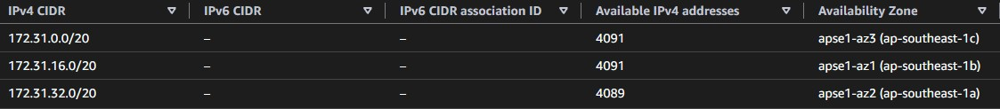
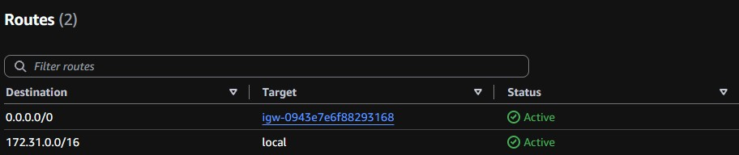
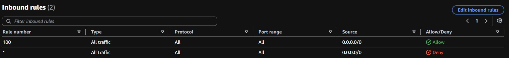
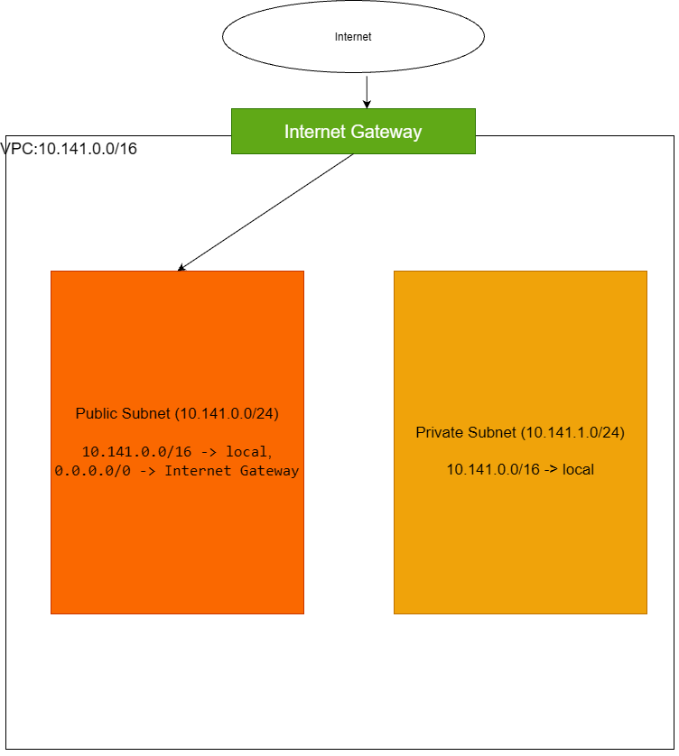

Assignment 2: Explore a VPC
- GitHub username: RoadriguezGlenn
- Value of X: 141

- IPv4 CIDR of default VPC: 172.31.0.0/16
- Number of IPv4 addresses: 65536

| Availability Zone | IPv4 CIDR |
| :--- | :--- |
| ap-southeast-1c | 172.31.0.0/20 |
| ap-southeast-1b | 172.31.16.0/20 |
| ap-southeast-1a | 172.31.32.0/20 |

- Available IPv4 count per subnet:
  - ap-southeast-1c: 4091
  - ap-southeast-1b: 4091
  - ap-southeast-1a: 4089
- Why the number is lower than 4,096: AWS reserves 5 IP addresses in each subnet (network address, VPC router, DNS server, future reserved use, and broadcast), leaving at most 4,091 usable IPs.
- Why one subnet shows a lower number: An active network interface (such as a running EC2 instance or ENI) is attached to that subnet, which consumes the missing addresses.

| Destination | Target |
| :--- | :--- |
| 0.0.0.0/0 | igw-0943e7e6f88293168 |
| 172.31.0.0/16 | local |

The default subnets are public. The route destination 0.0.0.0/0 targeting the internet gateway (igw-0943e7e6f88293168) provides direct two-way access to the public internet.

- State: attached
- Effect of detachment: If detached, all subnets lose their route to the internet; instances can no longer send or receive traffic outside the VPC.

- Count: 0
- Internet updates for private subnet: No. Without a NAT gateway or equivalent proxy, instances on a private subnet cannot translate private IP traffic to reach public internet update repositories.

- Inbound rules:
  - Rule 100: Traffic ALL, Protocol ALL, Port range ALL, Source 0.0.0.0/0, Allow
  - Rule *: Traffic ALL, Protocol ALL, Port range ALL, Source 0.0.0.0/0, Deny
- Difference from security group: A Network ACL is a stateless subnet-level filter evaluating both allow and deny rules in order, while a Security Group is a stateful instance/interface-level filter that only supports allow rules.

- Inbound rule:
  - Type: All traffic
  - Source: default security group (itself)
- Allowed traffic: Only resources assigned to that same default security group can send inbound traffic to an instance using it.

---

- Public subnet CIDR: 10.141.0.0/24
- Private subnet CIDR: 10.141.1.0/24

- **Public subnet route table:**
  - Destination `10.141.0.0/16` -> Target `local`
  - Destination `0.0.0.0/0` -> Target `internet gateway`
- **Private subnet route table:**
  - Destination `10.141.0.0/16` -> Target `local`

- Can you still open the instance web page from your laptop? No. Without the default route (0.0.0.0/0) pointing to the internet gateway, outbound return packets cannot reach your laptop over the public internet.
- Can the instance still reach another instance in the same VPC? Yes. The local VPC route (172.31.0.0/16 -> local) remains active, preserving direct internal network communication.

Put the database in the **private subnet**. Databases do not require public internet exposure; placing it in a private subnet keeps it shielded while remaining accessible to the web server in the public subnet via internal local routing.

### B6. Your question about VPCs
- Question: How does AWS prioritize routing when multiple overlapping routes exist (e.g., a specific /24 subnet route versus a broader /16 VPC peering route)?
- Origin: In this activity, route tables handle both specific subnets and default 0.0.0.0/0 paths simultaneously, prompting how longest-prefix matching resolves more complex overlaps.