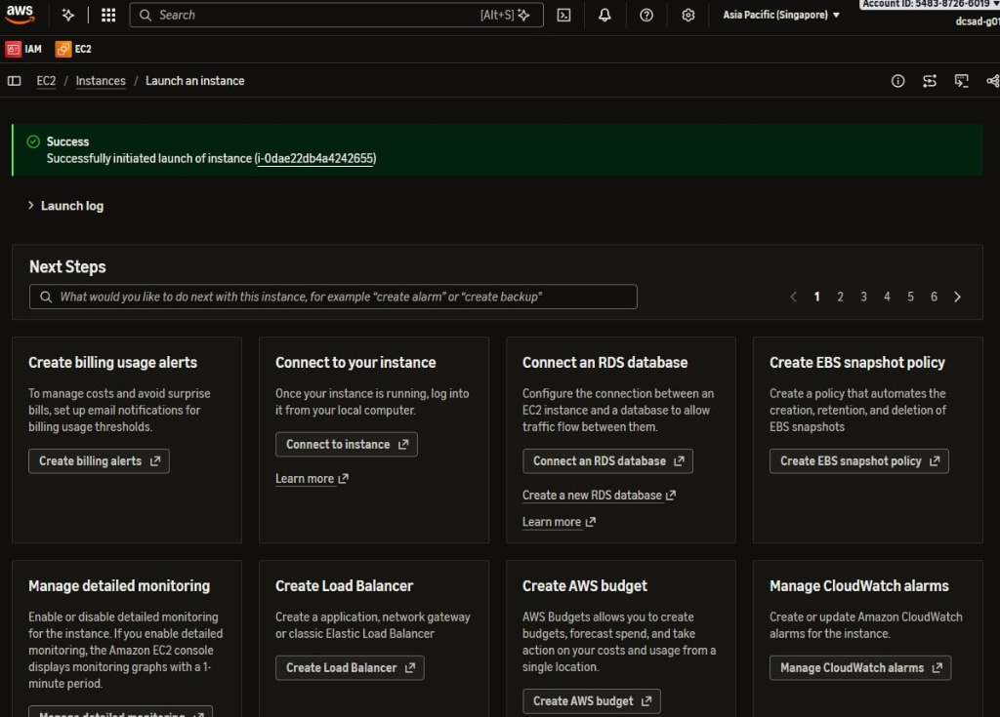
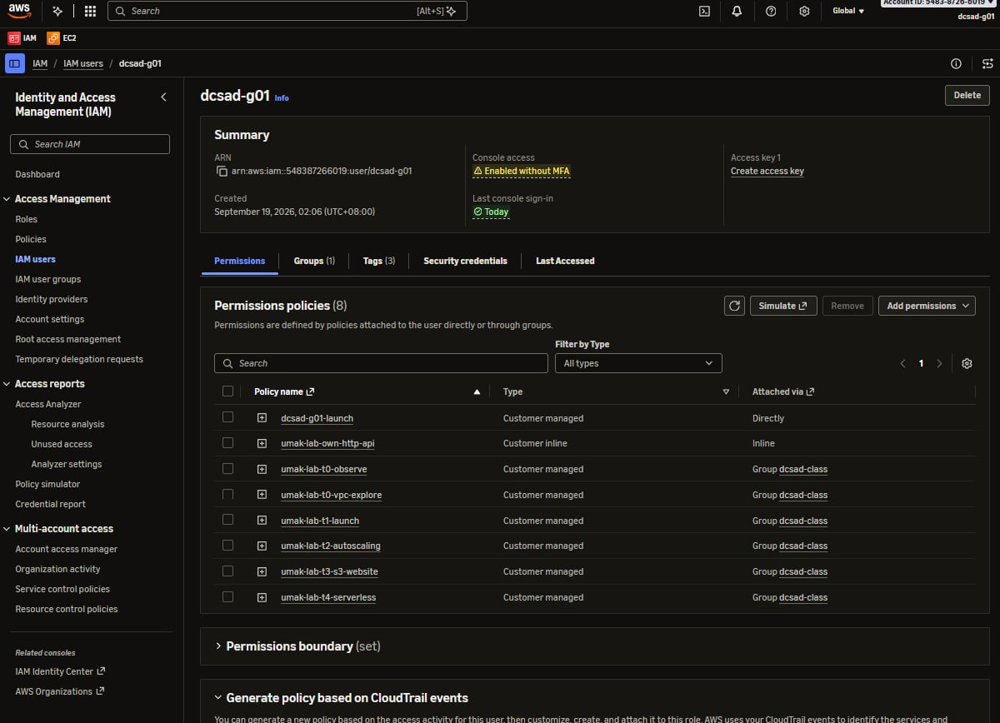
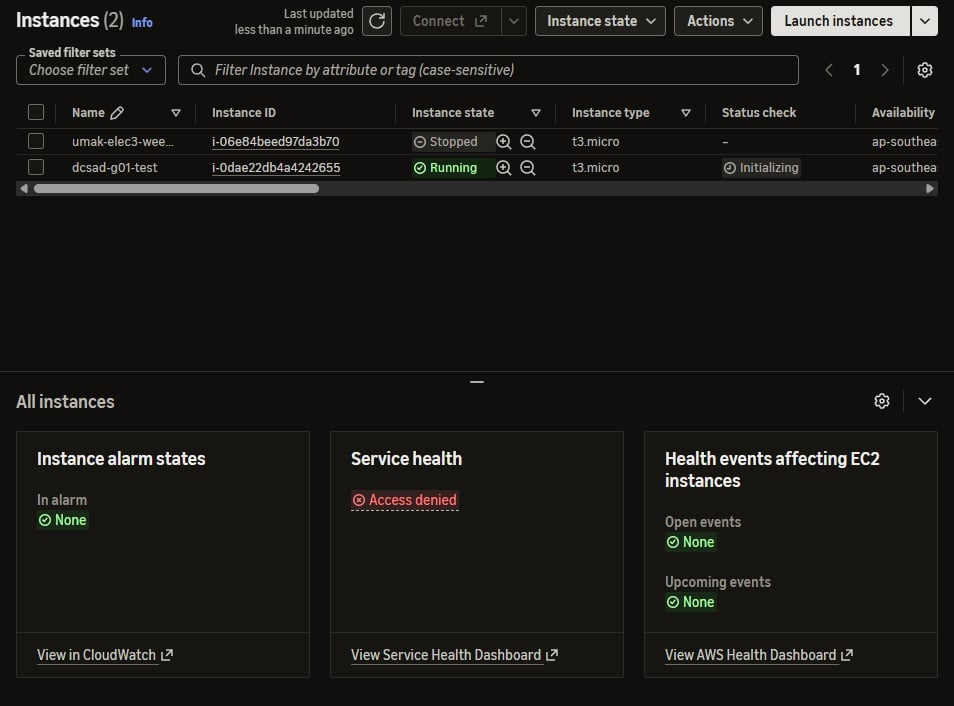
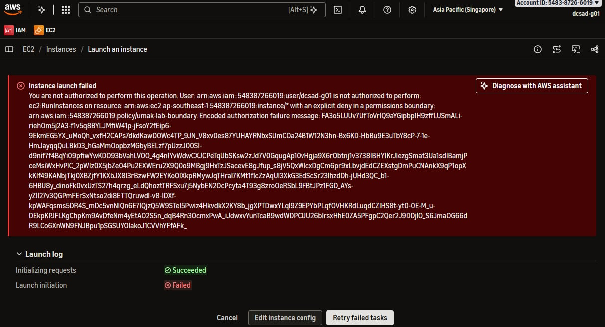
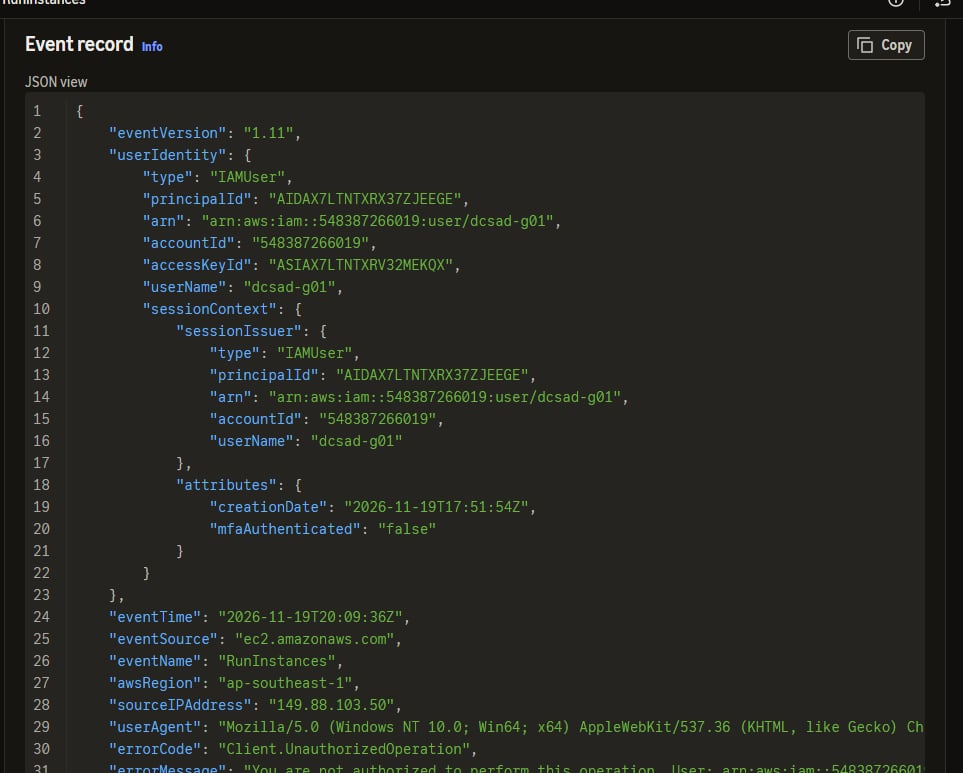

# Lab 1 Submission

## Part B

Error Action Name: This step would have displayed the live console authorization error for **ec2:RunInstances**, but because my groupmates had already attached the `dcsad-g01-launch` policy on our shared `dcsad-g01` IAM user prior to my walkthrough, the live denial was already resolved and the instance launch succeeded.

Screenshot (Part B launch denial with username visible): 

## Part C

Policy Statement Blanks:

* `"Action"` : `"ec2:RunInstances"`
* `"Resource"` : `"instance"`
* `"ec2:InstanceType"` : `"t3.micro"`

## Part D

Security Group Error Text: You are not authorized to perform this operation. User: arn:aws:iam::548387266019:user/dcsad-g01 is not authorized to perform: ec2:CreateSecurityGroup on resource: arn:aws:ec2:ap-southeast-1:548387266019:security-group/* because no identity-based policy allows the ec2:CreateSecurityGroup action.

Running Instance Time: November 20, 2026, 03:54 UTC+08:00 (19:54 UTC)

Screenshot 1 (Permissions tab listing -launch): 

Screenshot 2 (Instance in Running state): 

## Part E

t3.small / Tokyo Denial Error: Instance launch failed — You are not authorized to perform this operation. User: arn:aws:iam::548387266019:user/dcsad-g01 is not authorized to perform: ec2:RunInstances on resource: arn:aws:ec2:ap-southeast-1:548387266019:instance/* with an explicit deny in a permissions boundary: arn:aws:iam::548387266019:policy/umak-lab-boundary.

Screenshot 1 (t3.small or Tokyo denial): 

Screenshot 2 (CloudTrail event showing errorMessage): 

## Part F Questions

1. Which action did the Part B error name?
   `ec2:RunInstances`.
2. In your policy, which condition limits `ec2:RunInstances` ?
   `"StringEquals": { "ec2:InstanceType": "t3.micro" }` (restricts launches strictly to the `t3.micro` instance family/size).
3. After you attached `ec2:*` on `*` , why was `t3.small` still denied? Name the boundary statement.
   Effective permissions are the intersection of identity policies and the permissions boundary (`umak-lab-boundary`). The boundary statement `DenyAnyInstanceTypeButT3Micro` explicitly denies any instance type other than `t3.micro`, overriding `ec2:*`.
4. Why is `ec2:*` on `*` a poor policy even with a boundary?
   First, it violates the Principle of Least Privilege—if the boundary is ever detached, modified, or misconfigured, the user immediately gains full administrative control over all EC2 resources. Second, it still grants overly broad destructive or costly actions inside the boundary's allowed perimeter (such as modifying security groups, altering VPC routes, or terminating teammates' tagged resources).
5. In two sentences: what does the boundary control that your policy cannot?
   A permissions boundary acts as an overarching guardrail set by administrators that caps the maximum permissions any identity-based policy attached to the user can ever grant. Even if a user or developer attaches an unrestricted `Allow *` policy to themselves, the boundary still enforces hard organizational limits such as region locks, instance size caps, and mandatory resource tagging.
